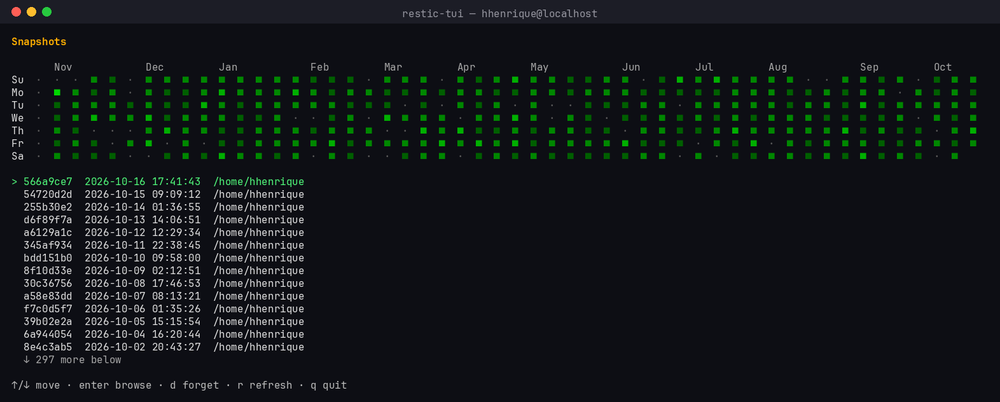

# restic-tui

A small terminal UI for browsing restic snapshots, navigating the file tree,
and restoring files/directories — built as a lighter, faster alternative to
running Backrest (web UI) just to browse and restore.

No container, no web server, no polling. It shells out to the `restic` binary
directly and reads `RESTIC_REPOSITORY` / `RESTIC_PASSWORD` / `B2_ACCOUNT_*`
straight from the environment, exactly like the restic CLI does.



*(Mock data — generated by `docs/gen_screenshot.py`, not a live capture.)*

## Requirements

- `restic` installed and on `$PATH`
- Repository env vars sourced before running, e.g.:
  ```sh
  source ~/.restic-env
  ```

## Build & run

```sh
go build -o restic-tui .
./restic-tui
```

## Automatic backups (systemd timer)

Backups run via a systemd **user** timer, not cron (this system has no
`crontab` binary — systemd timers are the native scheduling mechanism here).

Two units live in `~/.config/systemd/user/`:

- `restic-backup.service` — a oneshot service that runs:
  ```sh
  restic backup $HOME --exclude-file=$HOME/.restic-excludes
  ```
  with credentials loaded from `~/.config/systemd/user/restic-backup.env`
  (a plain `KEY=VALUE` copy of `~/.restic-env`, with `export` stripped —
  `chmod 600`, not committed anywhere).
- `restic-backup.timer` — triggers the service on a schedule.

### Current setup: daily

```ini
# ~/.config/systemd/user/restic-backup.timer
[Timer]
OnCalendar=daily
Persistent=true
RandomizedDelaySec=30min
```

`Persistent=true` means a missed run (e.g. laptop was off at the scheduled
time) fires as soon as the system is next up. `RandomizedDelaySec` spreads
the actual run time by up to 30 minutes so it isn't pinned to the exact
same second every day.

Enable/check:
```sh
systemctl --user daemon-reload
systemctl --user enable --now restic-backup.timer
systemctl --user list-timers restic-backup.timer   # next scheduled run
journalctl --user -u restic-backup.service          # backup run history/output
```

Trigger a run immediately (outside the schedule), e.g. to verify it works:
```sh
systemctl --user start restic-backup.service
```

### Switching to weekly instead

Daily and weekly aren't meant to run together against the same repo — daily
already covers everything weekly would, at the same storage cost (restic
dedups unchanged data regardless of cadence), so weekly only adds value if
you *replace* daily, e.g. to reduce how often the machine wakes up/spins disks.
To switch, edit the timer and reload:

```ini
# ~/.config/systemd/user/restic-backup.timer
[Timer]
OnCalendar=weekly          # runs Monday 00:00, or pick e.g. "Sun *-*-* 03:00:00"
Persistent=true
RandomizedDelaySec=1h
```

```sh
systemctl --user daemon-reload
systemctl --user restart restic-backup.timer
```

### Disabling

```sh
systemctl --user disable --now restic-backup.timer
```

## Shell warning: "backup is due" (scripts/backup-due-check)

`scripts/backup-due-check` prints a warning in every new interactive shell
if the last backup is stale or failed. It reads the `restic-backup.service`
systemd unit's own structured properties (`ExecMainExitTimestamp`, `Result`)
— **not** restic itself — so it costs ~15ms, not the ~3s restic pays per
invocation to derive its repository key. It only makes sense paired with
the systemd timer setup above, since it depends on that service's name and
state.

### Deploy

```sh
mkdir -p ~/.local/bin
cp scripts/backup-due-check ~/.local/bin/
chmod +x ~/.local/bin/backup-due-check
```

Then call it from `~/.bashrc` (after the interactively-only guard at the
top of the file), right after wherever you source your restic env vars:

```sh
[ -x ~/.local/bin/backup-due-check ] && ~/.local/bin/backup-due-check
```

Open a new shell (or `source ~/.bashrc`) to pick it up.

### Behavior

- **Silent** if the last run succeeded and is within the threshold.
- **Red warning** if stale:
  `⚠ Backup is due. Last backup was N day(s) ago on <timestamp>.`
- **Yellow warning** if the last run failed but isn't stale yet, or if the
  service has never completed a run.

### Configuring the threshold

Default is 3 days. Override via `BACKUP_DUE_DAYS`, e.g. in `.bashrc` before
the call:

```sh
export BACKUP_DUE_DAYS=7
[ -x ~/.local/bin/backup-due-check ] && ~/.local/bin/backup-due-check
```

## Features

- **Snapshot list** — browse all snapshots, newest first
- **File tree browser** — navigate into/out of directories per snapshot,
  with per-level caching so going back up (`esc`) is instant, no re-fetch
- **Type-ahead jump** — just start typing a file/folder name to jump to it
  (e.g. `gi` + `Enter` opens `git`, then `sand` + `Enter` opens `sandbox`)
- **Restore** — restore any selected file/dir to an arbitrary target path,
  with a full cursor-editable input field (arrow keys, Home/End, word-delete)
- **Snapshot management** — forget (delete) snapshots from the list view
- Scroll-aware rendering (alt-screen, windowed lists) — long directories or
  snapshot lists never push the header off-screen

## Controls

### Snapshot list
| Key | Action |
|---|---|
| `↑/↓` | move |
| `enter` | browse selected snapshot |
| `d` | forget (delete) selected snapshot |
| `r` | refresh list |
| `q` / `ctrl+c` | quit |

### File tree
| Key | Action |
|---|---|
| `↑/↓` | move |
| *(type letters)* | jump to first matching file/dir name (case-insensitive prefix) |
| `backspace` | edit the type-ahead search buffer |
| `enter` | open directory / confirm type-ahead selection |
| `R` (shift+r) | restore selected file/dir |
| `esc` | go up one level (instant, cached) |
| `Q` (shift+q) | quit |
| `ctrl+c` | quit (always works) |

Lowercase `r`/`q` are reserved for typing file/folder names in the search
buffer (e.g. a directory named `rea` or `qwirkle-sim`) — restore and quit use
the shifted, capitalized keys instead to avoid colliding with search input.

### Restore prompt
Standard text-input editing: `←/→` move cursor, `home/end` jump,
`ctrl+a`/`ctrl+e` (emacs-style), word-delete, etc. `enter` confirms, `esc`
cancels back to the file tree.

## Notes

- Forgetting a snapshot runs `restic forget <id>` (no `--prune` — space isn't
  reclaimed until you prune separately).
- This is a v1 built iteratively against a real ~300GB/multi-snapshot B2
  repository; rough edges are expected to surface with further use.
